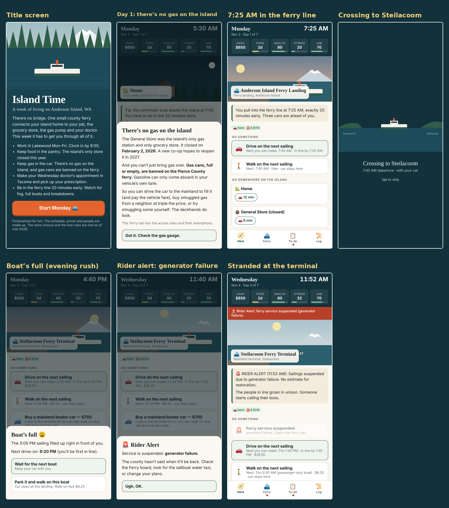
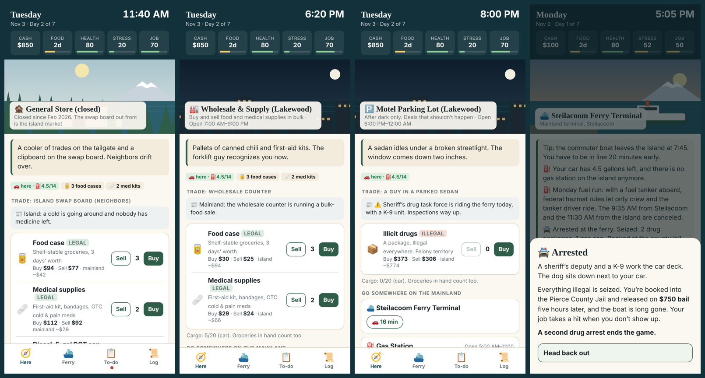

# ⛴️ Island Time

**A week of living on Anderson Island, Washington.** There's no bridge. One small county ferry connects your island home to your job, the grocery store, the gas pump and your doctor. Survive Monday through Sunday despite fog, full boats, breakdowns, a closed General Store and no gasoline on the island.



## Play

| How | What to do |
|---|---|
| 🌐 **In a browser** | Open **https://krazow.github.io/islandtime/** on any phone or computer. |
| 📴 **Offline, no install** | Download [`offline/Island-Time-offline.html`](offline/Island-Time-offline.html) (or grab it from [Releases](../../releases)) and double-click it. It's one file with everything inside, so it needs no internet or server. |
| 📱 **As a phone app** | Open the browser link. **Android:** tap *Install as an app* on the title screen. **iPhone:** Share → *Add to Home Screen*. It works offline after the first visit. |
| 🪟 **Windows** | Download `Island-Time-Setup.exe` from [Releases](../../releases). Installs per-user, no admin needed. Windows SmartScreen may warn about an unrecognized app (it isn't code-signed): *More info → Run anyway*. |

🎬 [**Watch the tutorial**](https://krazow.github.io/islandtime/tour/): six minutes on how to play, with subtitles.

📲 [**Install on your phone**](https://krazow.github.io/islandtime/install.html): QR code and step-by-step *Add to Home Screen* instructions.

## The game

- **Work** in Lakewood Monday–Friday. Clock in by 9:00, and the 7:35 boat is the only one that gets you there.
- **Ferry:** be in line 20 minutes early. Fog delays, commute boats fill up, Monday fuel runs cancel sailings, and breakdowns can strand you for a day or more. Then there's the neighbor's sailboat water taxi, the passenger-only backup boat, or a night in the Steilacoom terminal.
- **Food:** the island's only store closed in February 2026. Shop on the mainland, order delivery, or get takeout.
- **Gas:** there's none on the island, and gas cans are banned on the ferry. Drive over to fill up, pay Dale $12 a gallon, switch to diesel (two DOT cans are legal), or risk smuggling.
- **Medical:** make Thursday's doctor's appointment in Tacoma, pick up your prescription, and treat that sprained ankle.
- **Weather:** a November gale can knock out the power. Keep generator gas in the shed.
- **Island life:** power outages that reset your alarm clock and kill the well pump, dead car batteries with no tow truck on the island, trees down on the road, and neighbors who become friends (and give you rides). Wednesday night is **Bingo at the Riv**, hosted by the American Legion, with proceeds benefiting the Anderson Island Historical Society, Pierce County Fire District #27 or the Anderson Island Elementary Booster Club. Adding new events is easy: see [docs/EVENTS.md](docs/EVENTS.md).
- **Trading:** import food, medical supplies and fuel to the island and sell at island prices, which spike when the ferry is down. Or take a much bigger risk with illicit drugs, where a deputy's K-9 on the car deck or an undercover buyer means arrest.

### New in 1.8
- **Difficulty:** islanders pick 🌲 *Old-timer* (easier), ⛴️ *Normal*, or 🔥 *Ferry Hell* (summer tourists, constant breakdowns, score ×1.25); visitors pick 🌤️ *Easy Sunday*, 📸 *Tourist* or 🌧️ *Missed the Boat*.
- **One week or a whole month:** the month carries everything over, week to week. Help the islanders raise $2,500 and the old store reopens as the **AI Food Co-op**, with groceries and gas pumps on the island.
- **Jobs:** getting fired no longer ends the game. Hunt for work on your phone or the bulletin board, interview, and get hired. Options: line cook at the Riv (no ferry!), a Tacoma records clerk (best pay), or an early warehouse shift in DuPont.
- **Friendships grow:** friends level up (💛 → 💛💛💛) through favors you do for them, and they ask favors back. Perks include Sam's morning rides, Walt's job references, a Legion fish fry, and the Hendersons' pot roast.
- **Ferry trip planner** (⛴️ tab): pick where you need to be and by when. It tells you which boat to take, when to leave, when to be in line, and whether that boat tends to fill up.
- **Guided first day:** tips walk you through Monday. Trading and Dale unlock on Tuesday (or turn tips off).
- **Cleaner screens:** actions are grouped (Work, Ferry, Food, Fuel, Phone, Around here), and "Go somewhere" folds away.
- **More island life:** the school bus, a garage sale, Fire District #27's pancake breakfast, the Historical Society, Oro Bay, cookies in the ferry line. Eagle and Pajama Fred appearances are toned down.
- **Daily review** in the night summary: money, crossings, ferry waits and events.
- **Sound** (synthesized ferry horn and chimes) and **accessibility** options: larger text, high contrast, reduce motion.
- The doctor's appointment moved to **Thursday**, so Wednesday is just bingo night.

### New in 1.25.1: Island Time for Android, and a beta for testers

- 🤖 **Android app:** every release now has an APK on the GitHub release page, next to `Island-Time-Setup.exe` and `Island-Time-offline.html`.
- 🧪 **Beta for testers** at [krazow.github.io/islandtime/beta](https://krazow.github.io/islandtime/beta/), with its own saved games. New versions go there first; only a promoted release changes the main address.
- The offline cache only ever clears Island Time's own files.

### New in 1.25.0: updates find you, and delete from the start page

- ⬆️ **Update notice for downloaded copies:** the offline file and the Windows app check the website's `version.json` when they start (online only). If a newer version is out you get *Download*, *Later* (ask tomorrow) or *Skip this version*, with how to keep your saved games. Turn it off in ⚙️ Settings › *Check for updates*. The website and the app installed from it update themselves, as before.
- 🪟 **The Windows app stays current:** online, it opens the latest version from the website; the first time it brings every saved game, your name, settings and badges along (in the address's `#` part, which never leaves your computer; nothing already on the website is overwritten). Offline it opens its own copy, which the launcher now updates quietly in the background by running the latest installer with `--quiet`.
- 🪟 The installer now shows the right version in Windows' Apps list (it always said 1.3.1), and writes `game\version.txt`.
- 🗑️ **Delete from the start page:** each saved game has a 🗑️ beside its *Continue* button. It asks first.
- Windows apps installed before 1.25.0 don't have the updater yet: install `Island-Time-Setup.exe` once more over the old one (don't uninstall first, so your games stay).

### New in 1.24.1: one menu on the start page

- ☰ **One menu:** the start page's extra buttons (the weekly and daily challenges, Collections, Transfer a saved game, About Island Time) are now a single *Menu* button at the bottom. Its list opens upward over the page, so the start page still fits on one screen; tap outside or press Esc to close it. The Islander and Visitor cards keep Continue, Saves and 1 week / 1 month / 1 year.

### New in 1.24.0: pick how long you play, right on the start page

- ⛴️ **A one-screen start page.** Each card, 🏝️ Islander and 🧳 Visitor, has *Continue*, *Saves* and three buttons to start a new game: **1 week**, **1 month** or **1 year**. It fits a phone screen without scrolling.
- 🏝️ **Islander:** a week, a month (the co-op drive) or a year (story mode, four chapters).
- 🧳 **Visitor:** a week's visit in a rental cabin, a month as a weekend regular, or **a year as a weekend regular**: four months, one per season (summer, fall, winter, spring), with your money, island friends and reputation carried over and a house to buy any time. Visitors now pick the season too. (Day trips and weekend visits are no longer on the start page; saved ones still load.)
- ℹ️ **About** holds what the start page used to say: every way to play, the difficulty levels, saves, installing, and *What's new* with the video tutorial.
- 🎓 **A rebuilt video tutorial** (subtitled) for the new start page, at [krazow.github.io/islandtime/tour](https://krazow.github.io/islandtime/tour/).
- 📦 **Downloads renamed:** `Island-Time-Setup.exe`, `Island-Time-offline.html`, `Island-Time-web-<version>.zip` and `Island-Time-tutorial.mp4` (a hyphen, since a space breaks links). The old `IslandTime-` addresses on the website still work.

### New in 1.23.0: Islander or Visitor, right from the start

- 🏝️🧳 **Two cards on the title screen**, one for each way to play. Each has its own *Continue*, *Start a new game* and *Saves*. Islander covers living on the island (a week, a month, story mode) and the challenges; Visitor covers visits and the weekend regular.
- 💾 **Three save slots for each**, six in all. Saves from the old three shared slots are sorted onto the right card on update; nothing is lost. A weekend regular who buys the house moves to a free Islander slot, and challenges always start in an Islander slot.
- 🎚️ **Visitor difficulty levels:** 🌤️ *Easy Sunday* (20% more spending money, 40% less I-5 traffic, no crashes, emptier boats, a heads-up an hour before the last boat), 📸 *Tourist* (as before) and 🌧️ *Missed the Boat* (15% less money, 30% more traffic, fuller boats, more fog, no last-boat warning).
- 🌲 Islander's easy level is renamed *Old-timer* so it doesn't clash with the Islander card; *Normal* and *Ferry Hell* are unchanged.
- 🏷️ **Always know what you're playing:** the top of the game screen shows the way and the level, for example "🏝️ Islander · ⛴️ Normal" or "🧳 Visitor · 📸 Tourist".

### New in 1.22.3: start a new game, any way you like, and a day out in Seattle

- ⛴️ **Start a new game:** the title screen's *Start a new week* button is now *Start a new game*, and it asks how you want to play: 🏝️ live on the island (a week, a month or story mode), 🧳 visit the island, 🏙️ be a weekend regular, or take the 🏆 weekly or ☀️ daily challenge. The separate *Visit the island* button is gone; it's one of the choices now.
- 🏙️ **Going out in Seattle:** five real places, for residents and visitors alike: 🐚 Ivar's Acres of Clams on Pier 54 (waterfront seafood), 🍔 Dick's Drive-In on Broadway (late-night burgers), 🐟 Pike Place Market, 🗼 the Space Needle and 🎸 MOPOP, with real hours and 2026 prices. The drive is realistic: about 45 miles of I-5 and 55 minutes from the Steilacoom ferry with clear roads, and WSDOT-style traffic adds about 35 minutes northbound on weekday mornings, 40 southbound on weekday evenings, and 45 on a Friday afternoon heading south. A visitor who lives in Seattle now drives about an hour to the ferry with clear roads (it was 76 minutes). Trips around Seattle are short city drives, and rideshares (about $85) and the Sound Transit express bus ($3) are priced to match. For an islander it's a day out. They sit on a new 🏙️ Seattle map tab, drawn on the real shoreline.
- 🐛 **Fixed:** a visitor staying at the rental cabin was warned about the "last boat home" when the boat they needed went to the island. A visitor's home is on the mainland, so it now says "last boat back to the island", and the hints under *Go somewhere* point a visitor home to the mainland.

### New in 1.22.2: a video tutorial

- 🎓 **How to play, in six minutes:** a subtitled video tutorial covers starting out, the screen, the ferry, work and money, food and gas, the phone, friends and the house, your cars and boat, bedtime, visiting, and how a game ends. Watch it from **What's new** on the title screen, or at [krazow.github.io/islandtime/tour](https://krazow.github.io/islandtime/tour/).
- The older demo videos are retired in favour of the tutorial.

### New in 1.22.1: real maps

- 🗺️ **The tappable maps are drawn from real shorelines.** Anderson Island has its true outline (Amsterdam Bay, Oro Bay, Yoman Point), with McNeil Island and Balch Passage to the north. The mainland map runs from DuPont to Point Defiance and shows Steilacoom, Lakewood, Tacoma, University Place, American Lake, the Narrows and the islands.
- 📍 **Every place sits where it really is** (Geographic Names Information System points where they exist: the ferry landing, the old store, the schoolhouse, Lake Josephine, Florence Lake, Oro Bay). The cabin and Dale's place are fictional, so they sit somewhere plausible. Seattle and Olympia are off the map, so a visitor's home is pinned at the edge with the distance.
- ⛴️ On the mainland map both landings are in view, so the boat crosses the whole way.
- 🏙️ **Visitors from Seattle or Olympia get a home-city map tab** on that city's real shoreline, with their place, job and store.
- ✨ **What's new, on the title screen:** a button lists what changed in each release (newest first, earlier ones below) and plays that release's video. After an update, the update pop-up offers it too. Videos stream from the website, so they need internet.
- Shoreline data: [GSHHG](https://github.com/GenericMappingTools/gshhg-gmt) full resolution (P. Wessel and W. H. F. Smith, LGPL), generated into `src/js/49-geo.js` by `tools/make-geo.py`.

### New in 1.22: a fleet of your own (cars and a boat, each with its own parts)

- 🔋 **Every vehicle has its own parts:** each car has its own battery, tires and trouble history; a weak battery or a flat on one car never touches another. A flat puts that car on its donut spare until you buy a new tire at the Steilacoom gas station ($140); a second flat on the donut means a tow. Old saves give the shared battery to the island car. A visitor's or regular's newer car rarely has a dead battery.
- 🔥 **The Monday fuel run is a propane tanker** (there's no gas station on the island), and its notice now gives the sailings it really cancels: the 9:30 AM from Steilacoom and the 11:10 AM from the island.
- 🚤 **Where you keep the skiff:** choose at purchase and change it later (at the Riv or at home), with a cost / launch / risk comparison. A **slip** at the Riv ($90 a month, ready to go), **on its trailer in your yard** (free, tow it to a ramp), **on your mooring buoy** (free with the cabin's buoy upgrade) or in the **garage's third bay** (when you have one).
- 🛟 **The buoy keeps its promise:** the skiff lives off your own beach. Row out (about 10 minutes) and cross straight to Sunnyside and back home, no marina needed. A gale night can swamp it (outboard −40 and a bailing chore) or sink it ($350 salvage), unless you **haul it up the beach** first.
- 🚙 **Towing:** a $250 tow hitch per car at the Steilacoom gas station or Home Depot (the diesel pickup already has one; the Subaru can tow the skiff; the old Corolla can't). **Tow it to the Riv ramp and launch**, **haul out and tow it home**, or launch and haul at Sunnyside. At low tide the ramp is too shallow: wait or come back.
- ⛴️ **A trailer on the ferry** pays the vehicle-length fare for car plus trailer (30 to under 40 ft with the skiff aboard, $77.96 / $107.10 peak; over 22 to under 30 ft with an empty trailer behind the Subaru), and the skiff travels with that car until you launch it or park the trailer at the cabin, the Riv lot or the Sunnyside lot.
- 🌧️ **Yard upkeep:** rain fills an uncovered open skiff wherever it sits outside the garage bay, in the yard, a slip or on the buoy (bail it, or buy an $80 cover), and winter wears the outboard a little while it sits outside.
- 🚗 **Car deals are for islanders:** visitors and Weekend regulars are no longer offered the mainland beater or the diesel pickup at the Steilacoom terminal.
- 🏡 **Your city car moves with you:** when a Weekend regular buys the house, the car comes along (fuel, battery, spare tire) and is parked at the cabin. Or sell it right then for $2,500 and drive the old island Subaru.
- 💵 **Selling and swapping:** sell the mainland beater back at the terminal for $350, or trade the diesel pickup back for an old Subaru and get $600 back. The garage copes when a car leaves.
- ⛵ **Skiff gas:** shed gas fills the skiff only when it is at home; at the marina or Sunnyside, pour in a gas can you carry.
- 🔥 **Propane rides the Monday fuel run:** order it and it arrives on Monday (that day if you order before the run, otherwise next Monday).
- **🚗 Your vehicles card:** every car and your skiff in one collapsible card (Here tab, and a button on the map): where each is, fuel, battery, tires, outboard condition, and what's due (moorage, a new tire, a weak battery).
- **Parked cars in travel:** the Go-somewhere list and map show "your Corolla is here", and ferry and skiff options mention a car waiting at the far landing. Boat owners get a one-time tip to park the beater at the free Sunnyside lot.
- **Paid terminal parking:** $8 a night (cash) for each car left in the Steilacoom terminal lot, for islanders and visitors, except the car you sleep in. The Sunnyside launch lot is free.
- **Visitor hint at the terminal:** once per visit, drive on or walk on, with costs and what you can reach without a car.
- **Boat as a way home:** the "Leave your car behind?" prompt no longer warns boat owners whose skiff is at the other landing.
- **Outage backlog:** the next three sailings after an outage are fuller (more cars left behind), and the Ferry tab says so.
- **A friend drives your second car across:** text Sam or Walt, pay the car fare and owe them a favor; the car arrives at the far terminal on the next sailing.
- **Boat extras:** your skiff can carry up to two 5-gallon gas cans (the ferry bans them), a cooler and a few bags of groceries. In choppy water with cans aboard you choose: slow down (+10 min) or toss a can over the side.
- **Boater Education Card:** Washington requires one to run a motor of 15 hp or more (anyone born after Jan 1, 1955). Your bill of sale covers 60 days; after that, take the online course at home (2 hours, $10) for a card that is good for life, or risk an $87 marine patrol ticket.
- **Boat upkeep:** a yearly registration ($40), winterizing the outboard before the freeze (do it yourself in an hour or pay the marina $120), a hull cleaning each season for a slip boat ($60), and optional insurance ($15 a month) that covers storm damage and theft at the Sunnyside float.
- **The lot next door and a third garage bay** (month-long games and longer): once you own a boat, the neighboring lot comes up for sale (about $15,000: a long-term savings goal). Then a contractor, who rides the ferry, builds a third bay ($12,000, one to two weeks). A garaged skiff doesn't wear, can't be hit by a storm or stolen; service the outboard at home for less; stack more firewood. The garage card shows three bays.
- **Upgrades and resale at the marina:** navigation lights (no darkness risk), a fog horn and handheld GPS, a 25 hp outboard (faster, thirstier), and a fair resale by condition and upgrades.
- **On the water:** fish and crab from your own skiff with better odds than the dock, take a friend out for friendship and stress relief, and two story beats use the boat: Sam's becalmed sailboat and the Hendersons' shoreline photos.
- ⛽ **Late on the mainland with a low tank:** a Weekend regular can fill up and drive home instead of leaving the car at the terminal and paying for rideshares. A car that can't make a trip now says how much gas is left and where to get more, instead of "Out of gas".
- 🛞 **Gentler on the donut:** a car on its spare is half as likely to get another flat, and the "new tire" to-do is marked urgent.
- 🚶 **No false "stuck" message:** when the car boats are done but a walk-on (or passenger-only backup) boat still runs and you're carrying too much, the game says so instead of telling you you're stuck.
- 🗂️ **Boat storage follow-through:** after you change where the skiff lives, a to-do says where to move it; the map shows the skiff; the vehicles card knows a boat on the road and says how it's kept; selling it names the right empty spot; a car at Sunnyside stays reachable after the skiff is sold.
- 🦌 **Towing is still driving:** island trip events (deer, flats, trees down) can happen on a tow.
- 🤝 **A friend's car run survives a cancelled sailing:** they bring it on the next boat.
- The Weekend regular's moved car is "Your car (city car)"; the visitor terminal hint also shows as a tile.

### New in 1.21.1: small fixes

- ⚖️ **Fines, bail and reputation losses follow the level:** half on Islander, 50% steeper on Ferry Hell (Normal unchanged). Gains are the same on every level.
- 🧳 **Visits are tidier:** work sites, the pharmacy and the warehouse club no longer clutter a visitor's travel list or map (a Weekend regular only loses the islander's jobs). Your resident reputation no longer moves while you're visiting; a deliberate bad act counts against your visitor reputation instead.
- 🍳 **Islander's forgiving boss now covers the Riv weekend shift** too: no firing in your first week.
- ↩️ **Undo can't re-roll luck:** after an Undo, the same dice come up again, so retrying a hitchhike or a fishing cast gets the same result.

### New in 1.21: more to do, and a map
- 🏠 **A two-car garage at the cabin.** Bring the mainland beater over and both cars fit. Garaged cars are half as likely to have a dead battery on cold, dark mornings. When two cars are at the cabin (or anywhere you are), **choose which one to drive**: "Take the Corolla instead", and the game remembers your pick.
- 🛢️ **Dale's, expanded:** buy a new car battery from Dale ($189, installed in his driveway in 20 minutes, no ferry), and sell him 5-gallon cans of gas ($40) and diesel ($35), up to four a day. Gas you sell him goes back on his shelf. **Diesel in the shed:** buy a diesel can at the Steilacoom gas station, store it in the shed, and take it back out for a truck that ran dry or to sell to Dale.
- **🗺️ A map you can tap:** in 🧭 Go somewhere, switch from the list to a drawn map of Anderson Island or the mainland. It shows where you are, where your car is, the ferry route and the boat while it crosses. Tap a place to see how to get there. The list stays the default and the game remembers your choice.
- **⏩ Less waiting:** at a ferry terminal, **Wait for the 2:15 boat (35 min)** skips straight to boarding (outages, fog and full boats still apply). When you're away from the terminal and need the last boat of the night, your phone warns you 60 and 20 minutes before it goes.
- **🛡️ Are you sure? and ↩️ Undo:** the game asks before choices you can't take back and probably didn't mean: leaving your car behind, walking on after the last car boat, going to bed hungry with food in reach, skipping the last boat home on a visit's final day, buying the house in Weekend regular. After a simple action (moving, resting, buying) a one-step **Undo** button appears; it's gone once a day ends or an event fires. Settings has a switch to turn the prompts off.
- **Stories for your friends:** Walt (the Legion roof), Sam (runaway chickens and a fox), Bev (hats for the ferry crew), Rusty (thinking of selling the Riv) and the Hendersons (museum photos and a family reunion) each have a four-part story that unlocks as the friendship grows. Beats arrive by text and as events, each with a choice that costs time, money or effort. Pitch in twice and the story leaves a lasting perk: Rusty's free coffee, Sam's eggs, Bev's crew wave, Walt's shingle at the Legion, the Henderson photo wall. They work in the week, month and Story modes and in Weekend regular.
- **Memorable moments:** twenty small, kind events with a choice, weighted by season and time of day: orcas from the ferry, a king tide over the road, a potluck during a power outage, a lost dog, eagles fighting over a fish, a doe and fawn on Eckenstam-Johnson Road, a sea lion on the dock, a double rainbow, a chainsaw at 7 AM, fog so thick the ferry blows its horn, a kid selling lemonade, and more. At most one a day and three a week.
- **📒 Collections** (title screen and Settings), kept on your device across all games: a **photo album** of every photo you take, a **crossing log** (rides, first crossing, most in a day, 10/25/50/100 ride milestones) and an **island bingo card** of 25 things to see and do.
- **Things to do on the island:** fish off the Riv marina (a $20 Washington license, then cast, wait and set the hook: salmon in season, flounder, an old boot, and rockfish that have to go back), set a crab pot in July (keep males 6¼ inches or bigger, throw the females back; keeping an illegal crab is a bad act with a small chance of a ticket), pick Himalayan blackberries from mid-July (jam, or sell them at the swap board; watch the thorns), and play a real 5×5 card at Wednesday bingo at the Riv (tap to daub, call BINGO before somebody else does). They lower stress, cost time, and add a little to a visitor's score.
- **Your own boat:** buy a used skiff at the Riv marina ($2,500; a slip at $90 a month, or keep it on a trailer) and cross yourself between the island and the public launch at Sunnyside Beach in Steilacoom: a way around a canceled sailing, not a free shortcut. It takes 25–40 minutes and about a gallon of gas each way (no gas on the island except Dale’s), you arrive without your car, and storms, fog, chop, darkness, a low tide at the ramp and a dying outboard are all in the way. Residents only.
- **Holidays, on their real dates:** the Fourth of July (a parade, the Legion potluck, fireworks from the marina dock with the Sound packed with boats), Thanksgiving (the Wednesday-before ferry crush, then a friend's table, the Legion's community dinner or hosting the neighbors yourself), and Christmas from Black Friday on (the tree lighting at the Legion, decorating the cabin, a carol from the ferry crew, ZooLights in Tacoma). Halloween trunk-or-treat is in too, for any calendar that reaches October 31. A holiday only happens if its date falls inside your game.
- **Upgrade the cabin:** save up for a woodstove insert, rain-catch tank, solar panels and battery, generator transfer switch, heat pump, mooring buoy or insulation. Contractors come over on the ferry on a booked date (and wait out ferry outages). Upgrades carry across month weeks and story chapters.
- **Daily challenge:** a one-day version of the weekly challenge, seeded from your local date: same weather, sailings, outages and prices for everyone. Hit a quick goal (get to work on time, run the errands or make it home), get a score and an IT1 share code, and compare with friends on the same leaderboard.
- **More ambience:** under Settings → Ambient sound (Off by default), wind in storms, a crackling woodstove at home in the cool seasons, frogs at Lake Josephine on spring evenings, a distant ferry horn as the boat arrives, and a hushed night, all synthesized in the browser (works offline, follows the Sound setting).

### New in 1.20: Weekend regular

- 📅 **A fourth way to visit:** on the **Visit the island** screen, pick **Weekend regular: a month**, then where you live (**Seattle**, **Tacoma** or **Olympia**) and a difficulty. You live and work on the mainland Monday to Friday and spend the weekends on Anderson Island.
- 🏠 **Your city home:** rent (about $450 in Seattle, $325 in Tacoma, $300 in Olympia) is due every Sunday on every difficulty, with a late fee, a notice and an eviction after three missed Sundays. Dishes, laundry and trash pile up, the mail piles up, and the phone, utilities and car insurance bills come due like the islander's. A noisy upstairs neighbor and a stolen porch package are possible.
- 💼 **Your city job:** an office in Seattle (best pay, worst commute), the hospital records office in Tacoma or the state office in Olympia (steady hours). The same job meter and lateness rules apply, you can call in sick, and on Friday you can leave work early for the boat. You get **5 vacation days** for a Friday or Monday. Your boss may text you on the island: answering costs stress, ignoring it costs the job meter.
- 💵 **Money:** a paycheck every Friday replaces the visit budget, and everything comes out of it. The goal is to still have **$3,000** after rent and bills (**$2,500** on Hard), island reputation **40** and **3 island friends**. Progress is in the to-do list and the Visit app.
- 🌲 **Weekends on the island** use the visitor systems: the rental cabin (priced like an Anderson Island Airbnb, about $410 a weekend in fall), or a friend's spare room for free, house rules, sights and photos, packing food, I-5 traffic and the last boat on Sunday. Missing the last boat no longer ends the game; you find a couch or sleep at the landing, and a Monday morning stranded by a ferry outage is a missed day of work. On Sunday you can make it a **long weekend**: take Monday as a vacation day and stay one more night at the cabin (or with your host), then check out by 11 Monday.
- 🤝 **Island reputation and friends** carry over all month. Help out at the Legion, the farm, the store and the lake, and islanders become friends who text you during the week.
- 🏡 **Moving in:** when you meet the goal a house comes up. **Buy it** to end the month early with **You moved to the island**, then **Start life on the island** begins a resident game with your savings (minus the down payment), your friends and a reputation bonus. At the end of week 4 you get **A regular, not a resident yet** or **The island wasn't for you**. Rent you can't pay, a lost job or a medevac end the month early.
- Short visits and the resident game are unchanged.

### New in 1.19: visit the island, and go out on the mainland

- 🎟️ **Going out:** 15 real places on the mainland, in a **Going out** group in the travel list. Residents spend time and money to unwind (stress drops once per place per day, and a restaurant meal counts as dinner). Visitors score points for each different place they go out to, up to five.
  - **Steilacoom:** Topside Bar &amp; Grill (waterfront pub), The Bair (breakfast and lunch at the old soda fountain), Steilacoom Pub &amp; Grill (pool, karaoke, live music), the Steilacoom Historical Museum (spring and summer weekends) and Sunnyside Beach Park.
  - **Lakewood:** Yi's Traditional Korean Beef Soup, Hess Bakery &amp; Deli (German), Lakewood Playhouse, Lakewold Gardens and Fort Steilacoom Park.
  - **Tacoma:** Duke's Seafood on Ruston Way, Cactus in Proctor (Mexican), Point Defiance Zoo &amp; Aquarium, the Museum of Glass and The Grand Cinema.

- 🧳 **Visitor mode.** Tap **Start a new game** on the title screen and choose **Visit the island** to play a visitor instead of a resident. Pick a **day trip** (Saturday), a **weekend** (Friday evening to Sunday) or **a week**, and where you live: **Seattle** (about 45 miles), **Tacoma** (15) or **Olympia** (25). Then pick a difficulty.
- 🚗 **Getting there:** pack a cooler at home (there's no grocery store on the island), bring your bike if you like, and drive to the Steilacoom ferry. **I-5 traffic** can slow you down, worst at rush hour, on Friday afternoons and on summer Saturdays, and a crash can add up to an hour. Drive on, or walk on for less.
- 🛖 **The rental cabin:** check in from 3 PM, check out by 11 AM ($50 if you're late), and mind the house rules. It's priced from Airbnb's average for Anderson Island by season: about $205 a night in fall and $265 in summer, with 10% off a week. No job, rent, bills or chores, just spending money on top of the cabin: $150 for a day, $250 for a weekend, $660 for a week.
- 📸 **Things to see:** Lake Josephine, the Johnson Farm museum (weekend afternoons), Andy's Wild Wood Park, Jacobs Point, dinner at the Riv and whatever is on at the Legion. Take a photo at each one, and some are better at the right time of day.
- 🤝 **Islanders notice visitors:** wave back, park in the lot and pack out your trash, and they'll offer tips and rides. Block the ferry lane and they won't.
- ⛴️ **Catch the last boat home.** Making it home is worth the most points. Miss it, and the visit ends there. A 🧳 Visit app on your phone shows your plan, the last boat today, a checklist of sights and your photos.

### New in 1.18: difficulty levels that mean something

The three levels now change more than the numbers, and the title screen says what each one includes.

- 🌲 **Easy (Islander, now called Old-timer):** more money, fewer breakdowns and storms, emptier boats. A warming shelter at the Legion in storms, ferry warnings an hour ahead, a forgiving boss, and a house that wears slower and recovers faster.
- ⛴️ **Normal:** the game as designed, with no extras either way. The weekly challenge is always played on Normal so scores compare.
- 🔥 **Hard (Ferry Hell):** summer crowds, constant breakdowns, tight money, weekly rent ($125), car trouble, more lost packages (20% instead of 10%) and more raccoons, and no warming shelter. If you go broke, the Legion food pantry gives you a 5-day food box and your prescription once a week. Score ×1.25.
- Story mode uses the level you pick, and saved games keep the level they started on.

### New in 1.17: island reputations, a drug trade where only what gets noticed counts, real fuel use, and a weekly challenge

- 🏝️ **Every islander has a reputation now**, under the same rules as yours: 13 named characters and 12 background islanders do good deeds, let things slide, or get into trouble on their own each day. The 📣 Island Group shows **Island gossip**; your friends list shows each friend's tier; better-liked islanders answer your help posts more often and leave porch gifts; jailed characters can't help, and Dale's Place closes while Dale is in county jail. Story mode's epilogue names the best- and worst-liked islanders.
- 💊 **The drug trade, where only what gets noticed counts.** Four markets: the Riv marina and the old schoolhouse's back lot on the island; Ponders Corner (Lakewood) and Hilltop (Tacoma) on the mainland. Goods come in tiers (party drugs, pills, hard drugs, plus the old "illicit drugs"); weed is legal to buy at a licensed shop in Lakewood (up to an ounce), but reselling it is a crime. A deal costs nothing unless someone notices; the chance rises with how much changes hands, how busy the spot is, daylight, and heat from recent deals there.
  - **Noticed by police:** buyer and seller get the same punishment (arrest, bail, jail time by tier).
  - **Noticed by an island resident:** only the two people in the deal lose 15 reputation each.
  - **Nobody, or a mainland stranger:** nothing happens.
- ⛽ **Real fuel use:** gas burned = miles driven ÷ the car's mpg (island back roads ~25 mph, mainland ~32 mph; the Subaru gets 24 mpg, the beater 22, the diesel pickup 18). Cars use about a third of the gas they did.
- 🏆 **Weekly challenge:** one week, the same for everyone. Every player gets the same seeded week (season, jobs, weather, outages, Dale's prices) from the title screen's **Weekly challenge** button. At the end you get a score and a **share code** (or link). Paste a friend's code to compare; your challenge leaderboard is kept on this device.
- 🎯 **Tuned odds:** effort pays off. A steady player reaches the story's savings goal, while coasting falls a few hundred dollars short. Story epilogues no longer repeat or contradict the ferry and island lines.

### 1.16.2: an update notice

- 🎉 **When the game updates,** the title screen tells you which version you're now on (and which you came from), and upgrades all your saved games at once, listing which slots it updated. Click **Got it** to close it.

### 1.16.1: help when you run out of gas on the island

- 🛢️ **Call Dale to bring gas** wherever you ran dry on the island (the Riv, the lake, the landing): up to 5 gallons from his stock at half again his shop price ($18/gal instead of $12), about 40 minutes, cash. He answers 7 AM–9 PM, and not when he's out of gas. Gas only, not diesel.
- 📣 **Post in the Island Group for immediate help:** a neighbor brings 3 gallons of gas or diesel in about 25 minutes, but asking the whole island costs 5 reputation. Needs the Island Group app.
- Texting Sam and asking Pajama Fred still work as before.

### New in 1.16: Story mode, spring, and job listings that change

- 📖 **Story mode: a year on the island.** Pick "📖 Story" when you start a game. Four chapters, each a 4-week month, with the months in between skipped:
  1. **Summer: Moving in** (July 2026). You've just moved to the island. A ferry levy campaign is gathering signatures, and the co-op starts a year-long drive to reopen the store ($6,000 this time).
  2. **Fall: The vote** (November 2026). The levy goes to a vote on Tuesday, November 3. Then the ferry goes to dry dock for two weeks and a smaller relief boat fills in.
  3. **Winter: The storm** (January 2027). The storm of the decade: the ferry stops for over a day and the power is out from Wednesday night to Saturday.
  4. **Spring: The store** (April 2027). The co-op members meet at the Legion. If the fund made it, the store reopens.
  - **Between chapters:** a summary of the month and a "months later…" jump. Your money (+$400 if you had a job, −$300 if not), job, friends, reputation, house, phone and pets carry over; health and stress get a breather.
  - **Several endings**, decided by your reputation, money, job and the store: from 💚 *The heart of the island* (the co-op asks you onto its board) through *An islander now* and *Ferry commuter for life* to moving back to the mainland. The end screen adds an epilogue for the levy, the dry dock, the storm and the store, and a line for each chapter.
  - **The levy:** campaign in summer (signatures in the ferry line, the Island Group, flyers at the Fourth of July BBQ, talking with the Riv regulars, or arguing against it), then vote in November. Both sides get a fair say. If it passes, fares drop 10% and crew-shortage cancellations get rare; if it fails, fares rise 10% and cancellations get a little more common.
  - **The dry dock:** two weeks of a smaller relief boat: cars fill up, crossings are 5 minutes longer, a midday run sometimes cancels. Walk on.
  - **The storm:** check on the Hendersons, open your house as a warming spot, help the chainsaw crew clear the road, share gas or firewood, or sell your spare gas at storm prices (people remember). Neighbors look in on you if you're well known.
  - **The co-op:** a pie social at the Legion in summer, a $25 membership in fall (members get a discount once it opens), and the spring meeting. Short of the goal? There's a last push before the store's fate is decided. Cut the ribbon yourself if your reputation is +60 or more.
  - New achievements: 📖 A year on the island, 💚 The heart of the island, 🌉 No bridge to burn.
- 🤲 **Reputation only drops when you do something bad on purpose** (an arrest, a gas-can bust, runs for Dale, cancelling on a helper at the last minute, selling gas at storm prices) **or let your house fall apart** (Home under 25 for a week: −5). Bad luck no longer costs reputation: no more drift without good deeds, and no loss for raccoons in the trash, a favor you didn't get to (it still costs the friendship), a no-show or firing at the Riv (the Riv job meter still drops), or not being home when a helper came.
- 🦝 **Raccoons make you clean up.** The morning after raccoons get into the trash, you spend the first hour picking it out of the yard. That can make you miss your boat or run late. Missed favors no longer turn friends into enemies, and enemies no longer bad-mouth you. A bad name still heals slowly on its own.
- 🌱 **Spring** (April 2027), a fourth season for any game: plant a garden in the first two weeks and eat early greens later, spring cleaning, pollen days (an allergy pill at the Lakewood pharmacy helps), mud season on the island roads, frogs at Lake Josephine, and spring-break crowds on Friday and Saturday boats.
- 💼 **Job listings change every week.** Openings come and go; one can fill mid-week, another can open. Friends (or a good reputation) can tip you off about an opening, with a word in for better interview odds. New jobs:
  - **Holiday stocker, Lakewood supermarket** (fall only, Wed–Sun, $140/day)
  - **Ferry deckhand** (summer only, Thu–Mon from 5:30 AM at the island landing, $195/day)
  - **Clerk at the co-op store** (once the store reopens, $125/day)
  - Seasonal jobs end with their season: a layoff, not a firing.

### New in 1.15: island delivery

The island post office was inside the old store building, so it closed with the store. Now the carriers come to you.
- 📬 **Mail comes to your mailbox at home.** USPS delivers Monday to Saturday; today's mail is there after about 1 PM. "Check the mailbox" is in the 🏠 list at home. There's no more P.O. box.
- 📦 **USPS, UPS and FedEx deliver packages to your porch.** When you order online, pick how it ships:
  - 📮 USPS Ground Advantage: free, 3 days, no Sunday delivery, arrives by 1 PM.
  - 🟫 UPS Ground: $6, 2 days, weekdays only, arrives by 4 PM.
  - 🟪 FedEx overnight: $14, next day, no Sunday delivery, arrives by 11 AM.
  - 🏪 Hold at the Steilacoom pickup counter: free, 2 days, as before.
- Deliveries that land on a Sunday (or a Saturday, for UPS) slide to the next delivery day. Packages wait on the porch until you bring them in, and you bring them in automatically when you sleep at home. The to-do list tracks what's on the way.
- ❓ **1 in 10 deliveries goes to the wrong address**, and the 📣 **Island Group** app sorts it out (new **📦 Lost & found** section at the top of the app):
  - **Your package is missing:** tracking says "delivered" and it's not on your porch. Post "Missing package" and a neighbor who has it drops it on your porch a few hours later.
  - **A neighbor got yours:** sometimes they post first ("Got a package for you…"). Reply "That's mine!" and they bring it over.
  - **Someone else's package lands on your porch** (about 1 delivery day in 12): post "Found a package for…" and they come get it. A good deed: reputation +1, and maybe a new friend.
  - A letter that goes to the wrong mailbox just never arrives.
  - No Island Group app? The to-do list reminds you to get it from the App Store.

- 🤲 **Island reputation, −100 to +100.** You start at 0. The 📣 Island Group app shows a meter, your tier, what you're **known for**, and who isn't a fan.
  - **Tiers:** 🚫 Persona non grata (−100 to −60) · 🗣️ Talked about (−59 to −20) · 🙂 Newcomer (−19 to +19) · 🤝 Known (+20 to +59) · ⭐ Island regular (+60 and up). Perks move to +20 (first call on Gus), +35 (the co-op board) and +60 (Island regular).
  - **Up (+5 each):** helping a neighbor, the lake cleanup, Veterans Day, the fire drill, the holiday bazaar, your first Riv weekend shift each week, donating bingo winnings, finishing a friend's favor, every $100 to the co-op, returning someone's package (+10 the same day), making up with an enemy.
  - **Down:** a favor you never did (−2), a run-down house for a week, a scheduled Riv shift you skip (−5 each); Dale runs after the second (−5 each); fired from the Riv (−10); busted with a gas can (−20); arrested (−35).
  - **Drift:** above +20 you lose 5 a week without good deeds; below 0 you recover 5 every two weeks.
  - **Friends:** +1 extra friendship point when you're Known; gains halved when you're Talked about; as Persona non grata, casual friends stop answering.
  - **Enemies (up to 3):** the deckhand who cited you, a friend you let down twice. They bad-mouth you in the group, make help posts less likely, and give you the cold shoulder in the ferry line. Make up with them at home on a weekend, or wait: a grudge fades after about four weeks.
  - **Gifts:** Known players find a gift on the porch about once a week (eggs, jam, firewood); Island regulars two or three times a week (casseroles, a split woodpile, a spare ferry ride).
  - **Gig Work** shows your star rating: 4 tasks a day normally, 3 when Talked about, 2 at lower pay as Persona non grata. In good standing (0 or higher) you also get **island gigs** from neighbors: walk a dog ($15), a prescription run from Steilacoom ($12), a ferry-line errand ($10).
  - **The Riv:** line cook interview odds +0.3% per point above 0 (−0.75% per point below); no interview at −30 or lower. Weekend shifts need −10 or better, and Island regulars get $10 more a shift.
  - **The Riv weekend shift is now a second job with its own meter.** Working it puts you on the Friday/Saturday schedule (tell the kitchen to take you off). On time +3, late −4, a no-show −15 and reputation −5; at 0 you're fired from the Riv. A healthy second job adds a little to your score.
  - 📅 **Help posts are scheduled.** After picking what you need help with, pick when: 9 AM, 1 PM or 5 PM, today (at least 2 hours out) or the next two days. Be home: the helper waits half an hour. If someone came and you weren't there, reputation −3. If nobody answered anyway, no harm done.
  - 💬 **Friends text back faster when you're Known** (about 40% faster), and faster still as an Island regular (about 60%).
  - ✖️ **Cancel a scheduled help visit** from the Island Group app: free with 2+ hours' notice, reputation −2 at the last minute.
  - Old saves: reputation converts ×7.5, so every perk you had stays unlocked.
- 💼 **Job hunting fixes:**
  - On a weekend in a month game, applying books the interview for **early next week** instead of saying there are no slots.
  - Getting fired takes that job off the listings for **a week**, not forever. After that you can reapply, with 20% lower odds ("they remember firing you").
  - A new job **starts the next day**: no shift (and no missed-work penalty) on the day you're hired.
- ⌨️ **Keyboard shortcuts** on a computer: **1–9** press the numbered buttons (a small number shows on each), **H F T L** switch tabs, **P** opens or puts away the phone, **Backspace** goes back in the phone, **Esc** closes a pop-up, **?** shows the list. Also in ⚙️ Settings. They never fire while you're typing.

### 1.14.1: the real ferry and local fixes

- ⛴️ **The real 2026 ferry schedule.** Departures, the 7:35 commute boat, the midday gap, the first and last boats, Ketron stops and the Monday fuel run (skipped on holidays) now match Pierce County's published 2026 timetable. Summer adds the extra peak runs, and July 2–5 runs two boats.
- 💵 **Real fares.** Car + driver $24.94 ($33.86 in summer), walk-on $8.14. The Ferry Pass sells the county's **Value Pass**: 5 round trips for $96.08 (car) or $29.14 (walk-on).
- 🌙 **The Steilacoom terminal isn't open all night.** Stranded after the last boat, you sleep in your car in the ferry lot or on the covered bench outside. Same cost to your stress and health.
- 📦 **No parcel lockers.** Packages and Mainland Market groceries wait at a pickup counter by the Steilacoom ferry landing.
- 🎄 **The holiday craft bazaar** is at the new **American Legion Hall** location on the island.
- The lake cleanup stays at Lake Josephine (the lakes aren't connected).

### New in 1.14: eight real phone apps, a guided first week, feedback
**Phone apps** (5 slots, 8 to choose from; the old placeholder apps are retired and their slots freed)


Three new apps in the 🛍️ App Store. Each takes one of your 5 slots.

- ⛴️ **Ferry Pass** (replaces Ferry Alerts). The next 3 sailings from wherever you are, rider alerts, fog, ice and king-tide delays, and the last boat tonight. **Ticket books:** the county's Value Pass: 5 vehicle + driver round trips for $96.08 or 5 walk-on round trips for $29.14. Fares are only collected in Steilacoom, so that’s where a ride gets used instead of cash. Your tickets live on your phone: a dead phone means paying cash. **Push alerts:** the moment the county posts an outage, your phone buzzes, once per outage, even in your pocket.
- 🚗 **Island Rides.** Car out of gas, battery dead, or parked in Steilacoom? A neighbor drives you to the island ferry landing, or from the landing to anywhere on the island, for $8–12. Pickup in 10–30 minutes (longer early and late), no drivers 11 PM–5 AM, island only. A 🚗 option shows up under 🧭 Go somewhere for an hour. Sometimes your driver becomes a friend.
- 🌦️ **Tides & Weather.** Today and tomorrow in detail (gales, fog, ramp ice, snow, hard freezes, king tides, wildfire smoke and heat) and the rest of the week at lower confidence. It knows tomorrow’s weather a day before the morning gale warning, and buzzes you the evening before a gale, snow, ramp ice, a king tide or smoke (and on hard-freeze nights). Plus a tide table for Steilacoom, with king tides highlighted.


Three new apps in the 🛍️ App Store (each takes one of your 5 slots):

- 💳 **Island Credit Union.** Your balance, or your card balance when you’re in the red, with the $1,500 card limit and how much is left for essentials. It spells out what card debt is costing your score. Every bill is listed with its amount and due day, and you can pay any open bill (or all of them) from the app. **Autopay** pays each bill on its due day. If the money isn’t there it pays anyway and charges a $25 overdraft fee.
- 💼 **Gig Work.** Small remote tasks for dead time in the ferry line, at the terminal or in a motel: a survey (10 min, $3), transcribing a voicemail (20 min, $6), tagging photos (30 min, $8). Each costs battery and a little stress, and you get 4 a day. On the island’s one bar, every upload takes 10 extra minutes. It also shows your job or interview and opens the job listings, so it replaces Job Hunt.
- 🛒 **Mainland Market.** Order 3 or 5 days of groceries from anywhere, 7 AM–7 PM, at supermarket prices plus a $5 pickup fee. It can go on the card. Two hours later it’s waiting at the grocery pickup counter by the Steilacoom ferry landing: pick it up there (on foot you carry 4 days, and the rest waits). Leave it past 10 PM and the cold half spoils. One order at a time.


- 🩺 **Telehealth** (new, in the App Store). Video visits with a real doctor, once a day: 20 minutes, a $20 copay and a chunk of battery. It needs real signal, so it works on the mainland or on the Riv’s Wi-Fi. On the island’s one bar the video freezes on your own face.
  - 💊 **Renew your prescription** (Wednesday to Saturday, +$10 for the meds). It comes by mail and lands in your box the next afternoon around 1 PM. No pharmacy run, but it costs more than picking it up. Ask on Saturday and it arrives Sunday, after you’ve already run out that night.
  - 😮‍💨 **Stressed out?** A breathing exercise “for the ferry line.” Stress −8.
  - 🤒 **Run down?** Fluids, sleep, a vegetable. Health +3.
  - 🤕 **Your ankle:** a quick look on camera and “go to Urgent Care.” No charge. Telehealth doesn’t replace your Thursday checkup either.
- 📣 **Island Group** now shows your island reputation at the top, what it unlocks, and the last three replies to your posts.
- 🧹 **Retired apps.** Ferry Alerts, Job Hunt, Flashlight and Notes are gone from the App Store. Newer apps replace them. If you had any of them installed, the slots are free again, and you get a note about it once when you load your game.

**App balance**

With 8 apps and 5 slots, every app should be worth its slot and no single setup should be the right answer. We played a month (Normal and Ferry Hell) many times with a test player that installs a setup on day one and uses it every day. Then we nudged a few prices.

## What changed

- ⛴️ **Ferry Pass:** ticket books are now **25% off** (was 20%). That's $198.75 for 10 vehicle + driver crossings (was $212) and $46.88 for 10 walk-on crossings (was $50). A commuter who buys books uses about 15 rides a month and has a few left over at the end, so at 20% off the pass barely beat cash.
- 🩺 **Telehealth:** the copay is **$20** (was $25). Mail-order meds are **$10** (was $15), so a prescription renewal is $30 in all (was $40). The "I'm stressed out" visit now takes **stress −8** (was −6).
- 🛒 **Mainland Market:** the pickup fee is **$5** (was $7).
- No changes to Gig Work pay or limits ($3 / $6 / $8, 4 tasks a day), Island Rides ($8–12), the autopay overdraft fee ($25) or Tides & Weather. Gig Work was already worth about $170–190 a month to someone who works in the ferry line. Rides and Weather pay off in time and in storms more than in dollars.

## What the test player found (a month, 20 games each, the same luck for every setup)

| Setup (5 apps) | Normal: money vs no apps (median) | Ferry Hell: money vs no apps (median) | Also |
|---|---|---|---|
| 🧳 Commuter: Ferry Pass, Island Rides, Tides & Weather, Mainland Market, Gig Work | **+$224** | **+$294** | Less time standing in line. A little more stress from gigs. |
| 💰 Saver: Credit Union (autopay), Gig Work, Mainland Market, Ferry Pass, Island Group | **+$284** | **+$382** | Score +313 on Normal. |
| 🏡 Homebody: Island Group, Telehealth, Tides & Weather, Credit Union, Mainland Market | about even (−$25) | not measured | Lower stress all month, health +4 at the end, score +91. It's the best setup if you work on the island: no ferry for your prescription. |

So every setup comes out ahead, and none is more than about 30% better than the next.

## Smaller fixes

- 📋 **To-do: the storm.** "Be ready for the storm" now shows up only once the gale is known. That's the morning it hits, or the day before if you have 🌦️ Tides & Weather. The storm-prep actions at home (water jugs, power bank, generator) follow the same rule. Before, the To-do list warned you all week, which made the forecast app pointless.
- 🎟️ **Ferry buttons:** at the Steilacoom terminal, "Drive on" and "Walk on" now show **🎟️ ticket (n left)** instead of the cash fare when a Ferry Pass book will pay for the trip.
- 🔎 **Looking for work:** the To-do list and the "You're fired" note now point you to the 💼 Gig Work app (which has the job listings) or the bulletin board at the old store.

## Four new achievements (20 in all)

- 🎟️ **Commuter pro:** ride the ferry 10 times on Ferry Pass tickets in one game.
- 💳 **Never late on a bill:** finish a month with autopay on since the first week, and not one bill paid late.
- 💼 **Gig economy:** earn $100 from Gig Work tasks in one game.
- 🌦️ **Weather-wise:** spend a gale or a hard freeze at home after Tides & Weather warned you the evening before.

**Guided first week and feedback**
- **A guided first week** replaces the old first-day tips. One short tip at a time, in the same yellow box, as you reach each place: Monday is the commute (be in line 20 minutes early for the 7:35), work, groceries and gas on the mainland, and getting home; Tuesday your 📱 phone and its 5 app slots (trading unlocks); Wednesday bingo at the Riv and island friends; Thursday the doctor and your prescription; Friday and the weekend the house, bills, Gus and a day off.
- Winter and summer games get their own notes: ice on the ramp, dripping the faucets on freezing nights, tourists in the summer ferry line.
- After **Got it**, the next tip waits until you do something, so the Next up card gets its turn. Tips stay off if you turned them off.
- **📘 Replay the guided week** in ⚙️ Settings starts this game’s tips over.
- **💬 Send feedback** in ⚙️ Settings (and on the end screen): pick Bug, Idea or Something felt unfair, write a line or two, then open a GitHub issue or copy the report. The report adds the version, season, difficulty, day, place and your stats. Your in-game name is only included if you tick the box.

### New in 1.13: seasons, a fairer Hard mode, household life, polish
**Seasons**

- 🗓️ **Pick a time of year.** After difficulty and length, a new game asks for a season: 🍂 **Fall** (November, the original game), ❄️ **Winter** (January) or ☀️ **Summer** (July). Your pick is remembered for next time. The date, the HUD, the title screen’s Continue button, save slots, Settings and the end screen all show the season.
- 📅 **Real calendars.** Fall starts Monday Nov 2, 2026. Winter starts Monday Jan 4, 2027. Summer starts Monday Jun 29, 2026, so the Fourth of July lands on Saturday of week 1. A month is four weeks of that season.
- ☀️ **Summer: tourist season.** Kayaks, bikes and day-trippers fill the boats, worst Friday to Sunday and on every evening sailing. Days are long: outdoor work runs 6 AM–9 PM. No woodstove, so firewood and the chimney rest and propane is just for hot water. No fog, no gales.
- 🥒 **Summer garden.** Water it at home (20 minutes). Keep it watered and it hands you a day of food every few nights. Skip three days and it dies.
- 🚫 **Burn ban.** A brush pile builds up in summer. Chip and haul it (75 minutes), or burn it in 20 and risk a $250 Fire District citation.
- 🎆 **The Fourth of July.** The Legion BBQ at the Riv (11 AM–3 PM, $12, you’ll meet Walt), fireworks over the water from 9:30 PM, packed and late ferries all weekend, and illegal beach fireworks until 1 AM.
- 🔥 **Wildfire smoke.** Some summer weeks bring a smoke day. Outdoor work is off, and walking around outside costs you health.
- ❄️ **Winter: ice and snow.** After freezing nights the ferry ramp ices up and morning boats run late. Sometimes the crew stops sailings to sand the transfer span. Snow days and icy mornings make island roads slow, and sometimes you slide into the ditch.
- 🧊 **Frozen pipes.** On a hard-freeze night with no heat (no fire in the stove and the propane is out, or a power outage without a generator), a pipe can burst: $280 plumber, Home −15, no water in the morning. **Drip the faucets** at home (5 minutes) to stop it.
- 🌊 **King tides.** One winter morning a week, an extreme high tide floods the Oro Bay road (+20 minutes) and slows ferry loading.
- 🌑 **Short days, long nights.** Winter outdoor work is 8 AM–4 PM. More storms and power outages, the woodstove and propane furnace burn faster, and gutters and moss grow more slowly.
- 🎨 **The scene changes.** Snow on the trees, the roof and the ground in winter. Bright sky and green firs in summer, sun up past 9 PM, and an orange sky on smoke days.
- 💬 **Seasonal mornings.** New morning lines for winter and summer, plus forecasts for ice, king tides, hard freezes, smoke and the Fourth.
- Winter bosses go easy: on days with ice on the ferry ramp or snow, being late costs much less and a missed day costs −6 job instead of −15.
- Dripping the faucets covers three nights, and a heated house won’t freeze.

**More ways to earn (and a fairer Hard mode)**

- ⏱️ **Overtime.** After a full shift at your mainland job, stay 2 more hours at time and a half ($64 at the Lakewood office, $69 at the warehouse, $81 at the hospital). You can do it once a day. It costs stress, and you will probably miss the boat you planned to take. The Riv line-cook job has no overtime.
- 🍳 **A second job at the Riv.** On Friday and Saturday evenings (4–10 PM) the Riv is always a cook short. You get $48 plus tips, and the staff meal counts as dinner. Your first shift each week adds 1 to your reputation, and you may meet Rusty or Walt. This doesn’t affect your main job, and it isn’t offered if the Riv is already your main job.
- 🪵 **Sell firewood.** Once a day you can put a bundle in the honor box at the end of the driveway. It pays $19 in November, more in winter and less in summer. You can only sell while you have more than 4 nights of wood, so you always keep enough to stay warm.
- 🐔 **Backyard hens.** A coop with 3 hens costs $120 at Home Depot and comes over on the ferry the next day with two weeks of feed. A close friend like Sam will give you hens for the cost of the lumber. Collect the eggs at home, sell a dozen to the neighbors for $6 (once a day), or turn a dozen into a day of food. Buy feed at Home Depot ($18 for 20 days) or at the co-op once it opens. Without feed, the hens stop laying.
- 🤲 **Reputation unlocks**, announced once when you reach them and listed in the 📋 To-do tab and the 📣 Island Group app:
  - **3: First call on Gus.** He comes the next morning and always shows up.
  - **5: The co-op board.** Once a week, pin a card at the old store. A few hours later someone buys your firewood or eggs at a better price, or you get a free find: firewood, a box of groceries, a cooler, mouse traps.
  - **8: Island regular.** Takeout at the Riv costs $20 instead of $27, and you get a free coffee in the ferry line every day.

**Household life**

- 🧾 **Bills.** Electric (Island Power & Light Co-op), internet (OneBar Wireless), phone and home insurance (Fir & Tide Mutual), each due on its own day. In a one-week game they’re all due that week; in a month they’re spread out. Pay at home (🏠 Inside the house → 🧾 Pay bills): online in 5 minutes, or mail a check that takes 2 days to get there. Late means a late fee and a little stress. After a week you get a stern letter (the co-op’s is pink). After two weeks it goes to collections and lands on your card with a fee on top; for electric, that fee is the reconnect. Anything still unpaid when the game ends gets settled then. Electric runs higher in winter and lower in summer.
- 📬 **Mail.** USPS brings letters to your mailbox at home, Monday to Saturday after about 1 PM: bill statements, a seed catalog, a jury summons you get out of by living on an island, the co-op newsletter, and now and then a check for $12.40.
- 📦 **Packages.** Order online at home: mouse traps, a power bank, a well-pump pressure switch, dog food. Pick a carrier (see 1.15) or have it held at the pickup counter by the Steilacoom ferry landing.
- 🗑️ **Trash and dump runs.** A bag a night piles up by the shed. The island transfer station is open Wed, Sat and Sun, 9 AM–3 PM (also Fridays in summer, from 10 AM in winter). The dump run is in 🌲 Outside & property: load the car, 50 minutes, about a gallon of gas, $8–24. At 8+ bags the house slips a little each night, and raccoons may spread it across the yard.
- 🐶 **A dog (optional).** A neighbor’s litter may turn up at the end of the road, or the county shelter van parks in the Steilacoom terminal lot on Saturdays ($85). A dog needs food (a bag lasts 30 days: Lakewood supermarket, Warehouse Club or online) and a walk every day. Walking at Lake Josephine counts and you might meet someone. A fed, walked dog lowers your stress at night. A hungry or unwalked one costs Home and stress, and so does leaving it alone overnight. If you never adopt, none of this costs you anything.
- 🍳 **Cooking at home.** Cook a real dinner (4–10 PM, 45 min): health +2, stress −4, no extra food, and cheaper than the Riv. On a day off, batch-cook (2 hours): +1 day of food and 5 nights of good leftovers.
- 🌬️ **Storm prep.** When a gale is in the forecast, the house fold-outs add: fill water jugs and the bathtub (the morning with no well pump stops being a stress hit), charge the power bank (your phone and its alarm last through the outage), and top off and test the generator (it starts on the storm night even if it’s overdue for service). The To-do storm item shows a prep line.
- When you’re broke, groceries and your prescription can go on the credit card (up to $1,500), like ferry fares and motels. It still counts against your score.

**Polish**

- 📸 **Share your week.** The end screen (win or game over) has a **Share my week / Share my month** button. It draws a 1080×1350 picture of your game: your name, season, difficulty, grade and title, score, cash, health, job, stress, home, nights stranded, ferry crossings, the achievements you earned this game and the friends you made, plus the link to play. You get a preview first. Then **📤 Share** sends it to your messages or socials on phones that support it, or **⬇️ Save the picture** downloads `island-time-<your-name>.png`. It's all drawn on your device. Nothing is uploaded.
- ♿ **Screen readers.** New narration lines, event tiles and pop-up titles are read out as they appear. Pop-ups are announced as dialogs with their titles.
- ⌨️ **Keyboard play.** When a pop-up opens, focus moves to its first button. Tab stays inside the pop-up, and closing it puts you back where you were. Focus also stays in place when the screen refreshes, so checking off a priority or moving it up or down doesn't send you back to the top. Priority items can be checked off with Enter or Space. Press Enter or Escape to skip the ferry crossing animation.
- 🔎 **Visible focus.** Every button shows a clear orange focus ring when you use the keyboard. High contrast mode makes it a black-and-yellow ring.
- 🏷️ **Every button has a name.** Icon-only buttons (✓, ✕, ▲▼✏️🗑️, 📌, ⚙️, 📱 with its badge count) all have spoken labels. The tab bar marks the current tab.
- 🌧️ **Ambient sound** (⚙️ Settings → **Ambient sound: Off / Low / Medium**, off by default). Rain that gets heavier on rainy and stormy nights, gulls at the ferry landings, the ferry's engine rumbling during a crossing, and a quiet wind in the firs at home. It's all synthesized, with no audio files. It needs 🔊 Sound on, only starts after you tap or press a key, and pauses when you switch away from the game.

**Sharing**
- 📲 New page: [Install on your phone](https://krazow.github.io/islandtime/install.html), with a QR code and step-by-step instructions.
- YouTube kits for the 1.11 and 1.12 trailers are in `docs/youtube/`.

### New in 1.12: your phone 📱
Tap 📱 in the top bar to pull out your phone. Its battery is the same one the game already tracks, so a dead phone means no texts or calls.

**A note on Sam's rides:** Sam no longer turns up automatically. Ask him by text or call from home before 10:30 AM.

**Messages**

- 💬 **Text your friends.** Open 📱 → Messages to see everyone you’ve met on the island, their last text, and a dot for anything unread. The red badge on your phone counts unread texts.
- ✍️ **Tap to text.** Quick replies (“On my way!”, “Running late. Ferry’s a mess.”, “Thanks again!”) and “How’s it going?”, which builds the friendship once a day (shared with calls). Each text uses a little battery.
- ⏳ **Replies take island time.** Friends answer in a few minutes to half an hour (close friends faster), later if they’re busy, and the next morning if you text after they’ve gone to bed.
- 🤝 **Ask Sam for a ride.** From home before 10:30 AM, text Sam. If Sam says yes, “🤝 Ride with Sam” shows up when you head to the ferry landing.
- 🩴 **Ask Pajama Fred about the boat.** Once he’s a good friend, his deck-crew buddy tells him when the next breakdown is coming, today or tomorrow.
- 🎱 **Bingo tonight?** Text Walt or Rusty on Wednesdays. On the mainland, ask the Hendersons if they need anything. They always do.
- 📨 **Friends text you first**, about once a day: ferry-line warnings, eagles, leftovers, chickens. Answer the same day and it counts as keeping in touch.

**Phone calls**

- 📞 **A Phone app.** Open your 📱 phone and tap Phone: Contacts (your island friends), Island numbers and Recents.
- 💬 **Call your friends.** Catching up takes 15 minutes, lowers your stress and counts toward the friendship (once per friend per day, shared with texting). Calls use a little battery.
- 💤 **They don’t always pick up.** Call late at night or when they’re busy and it rings out. Leave a voicemail: they like hearing from you.
- 🚗 **Ask Sam for a ride** to the ferry when you call him from home before 10:30 AM.
- 🩴 **Ask Pajama Fred about the boat.** Once he’s a good friend, he tells you exactly what his deck-crew buddy heard about outages today or tomorrow.
- 💼 **Out of work? Call Walt.** He has advice, and once you’re good friends he’ll put in a word.
- 🍲 **Dinner with the Hendersons.** Call them Friday to Sunday and they’ll handle dinner (pot roast, obviously).
- 📲 **Friends call you, too.** Every few days someone rings. Open your phone within half an hour to answer, or find a missed call (and maybe a voicemail) in Recents.
- 🧰 **Gus and the Riv moved into your phone.** Book Gus the handyman and reserve your Wednesday bingo table under Phone → Island numbers.

**Apps (5 slots)**

- 🛍️ **App Store.** Your phone has room for **5 apps**. Install, open and remove them from the App Store. On the island’s one bar of signal an install takes about 6 minutes; on the mainland, a minute. Full? Remove an app to make room.
- ⏰ **Clock.** See both alarms at a glance and set them from your phone.
- 📣 **Island Group.** The Anderson Island community group now lives on your phone: post asking for help (once a day) and get a badge when the replies come in. The old “Post asking for help” button on the main screen is gone.
- ⛴️ **Ferry Alerts.** The next 3 sailings from wherever you are, rider alerts, fog delays and the last boat tonight.
- 🔎 **Job Hunt.** Your current job or interview, and the job listings, one tap away.
- 🔦 **Flashlight.** Handy in a power outage (and it calms you down a little the first time you switch it on), but it eats about 1% battery every 10 minutes.
- 📝 **Notes.** Your priorities list in your pocket: add a note or a quick one, tap to check it off.
- 💡 **New tip** about what your phone can do.

The five installable apps are placeholders for now. Each one is a self-contained plug-in in `src/js/14-phone-apps.js` (see the comment at the top for how to add or replace an app).

### 1.11.1: under the hood
- The game's code is now organized into modules in `src/` and built into the single `index.html` with `tools/build.py`. Nothing changes for players; the automated tests check that `index.html` always matches `src/`.

### New in 1.11: island help, Next up, island life, achievements
**Island help for your house**

- 🧰 **Gus, the island handyman.** Call him from home (🌲 Outside & property). Pay $90 cash, 5 gallons of gas from your shed, or 2 days of groceries, and he fixes the 3 jobs that need it most. He lives on the island, so ferry outages can’t stop him. Island time can: sometimes he shows up a day late.
- 💛 **Gus becomes a friend.** Keep calling him and he gives you the friends rate ($60), then starts doing your dishes and laundry too.
- 📣 **Post in the Anderson Island community group.** Once a day, ask for help with a specific job or general help around the house. Replies come in a few hours: a neighbor might show up, lend you a tool, flood your phone with twelve replies, argue in the comments, or try to sell you gutter guards.
- 🤲 **Help a neighbor.** Spend an hour (8 AM–7 PM) helping someone from the group. It lowers your stress and builds your island reputation. More reputation and more friends mean better odds when you ask for help, and you might make new friends along the way.
- 🛠️ **Community work parties.** Help enough people and neighbors may show up on a weekend morning with ladders and a pie to fix your two worst jobs.
- 💡 **New tips** explain the Home meter, the 🏠/🌲 upkeep lists and what to do when your house is run down.
- 📖 **How your house works**, a new page in Settings ⚙️, explains the Home meter, chores, maintenance, ferry-bound contractors, Gus, the community group and reputation.

**Next up**
- New **Next up** card at the top of the 🧭 Here tab: one suggestion for what to do now: today's shift, an interview, the doctor's appointment, your most urgent to-do, bedtime (with your alarm), or a house chore that's due.
- Commuting from the island? Next up names the boat to catch and when to leave. Tap it to open the ⛴️ trip planner, already filled in.
- Your own #1 priority from the 📋 To-do tab shows as a second line ("📌 Your #1: …").
- Tap a house chore suggestion to open the right 🏠/🌲 list. Tap ✕ to hide the card for the rest of the day.

**More life on the island**

- 🇺🇸 **Veterans Day, Wednesday Nov 11** (month mode): the American Legion holds a ceremony at 11:00 AM by the flagpole outside the Riv. Show up and you’ll leave calmer, and closer to Walt (or finally meet him).
- 🎄 **Holiday craft bazaar** at the American Legion hall, Saturdays in weeks 3 and 4 (and some Saturdays in a one-week game). Buy a cedar wreath for your door (Home +3) or just browse for fudge. You might meet Bev, who knits, has opinions, and grows far too much zucchini.
- 🗑️ **Lake cleanup day**: grab a bag at Lake Josephine on a Sunday morning and work your way around the shore. Two hours, one lawn chair, nine golf balls, and a friend working the bag next to you.
- 🚒 **Fire District #27 drill**: a Thursday night drill at the station by the old store. Roll some hose, get a little healthier, meet Rusty in an unexpected outfit, and the volunteers check your chimney on the way home.
- ⛵ **Sam’s boat project**: a $200 wooden skiff with “character.” Help scrape, sand or chip in, and be there when she (probably) floats.
- 🧢 **Walt’s grandson**: Tyler is over from Tacoma and lives on his phone. Show him the eagles, teach him the woodpile, and come to the Legion send-off.
- 💍 **The Hendersons’ fiftieth**: invitations, a cake situation, and an anniversary brunch with a fiddle.
- Friend stories unfold over the month as friendships grow, one small choice at a time. “Not now” is always an option. The island remembers, gently.

**Achievements and save slots**
- 🏆 **Achievements.** Earn 20 achievements for island milestones, such as never getting stranded, riding on Ferry Pass tickets, sweeping the chimney before it's a fire risk, winning at bingo, making a close friend, or surviving Ferry Hell. They're saved on your device and carry over to every new game and save slot. See them in ⚙️ Settings → 🏆 Achievements, where locked ones tell you how to earn them. The end screen lists any you earned that game.
- 💾 **Three save slots.** Keep up to three games going at once. On the title screen, tap 💾 Save slots to continue, start a new game in, or delete each slot. While you play, ⚙️ Settings → 💾 Save slot lets you switch slots, and your current week is saved first. Your existing save is now slot 1, so nothing is lost.
- Continue, Start a new week, Exit and transfer codes all use your current slot.

**Reliability**
- Loading a save made by a newer version of Island Time (on this device, or from a pasted transfer code) now loads everything it can and shows a one-time warning naming both versions, so you know to update the game before you lose anything.
- Added an automated test suite (Playwright, Chromium) that checks the title screen, new week and month games, every tab, save and reload, upgrading old saves, the priorities list, house upkeep, the end-of-week screen, the newer-save warning, and a 1,500-step robot playthrough. It runs on every push and pull request.

### 1.10.1 fixes
- **Resting has diminishing returns:** the first hour of rest in a day takes −8 stress, then −5, −3, and −1 after that, so you can't sit at home and grind stress to zero.
- **Mice leave your last day of food alone**, so they can't send you to bed hungry.
- **Small phones with extra-large text:** the stat bar wraps into two rows instead of pushing the Home tile off-screen.

### New in 1.10: your house
- **🏠 Home meter** (0–100, next to Job): it slips every day, more on workdays, in busy weeks, and after storms and outages. Below 35 you sleep worse, the house breaks down more, and friends visit less. At 75+ you rest better, wake to cozy mornings, and earn up to +180 points at the end.
- **Inside the house** (fold-out at home): daily chores (dishes, laundry, sweeping up cedar needles, making the bed) that pile up when skipped; a deep clean on your day off; fridge cleanout after an outage; wiping condensation to stop **black mold**; woodstove ash, chimney sweeping (or a **chimney fire** and a visit from Fire District #27) and splitting firewood; mouse traps from Home Depot; and septic pump-outs.
- **Outside & property:** clear the gutters (or the crawlspace floods in heavy rain), trim the limbs over the roof yourself (risky) or hire a tree crew, service the well pump (fewer "no water" mornings), treat roof moss (or the roof leaks), fill driveway potholes (or get flat tires), service the generator (or it may not start in an outage), and order propane.
- **Contractors ride the ferry:** the septic truck, tree crew and propane truck come over the next day, and get stuck on the mainland when the ferry is down.
- Outdoor work is daylight-only (7 AM–5 PM). The To-do tab lists whatever needs attention.

### New in 1.9
- **My priorities** (📋 To-do tab): your own editable, ordered list under "This week". Add anything, tap 📌 on a weekly task to pin it, reorder with ▲▼, edit ✏️, delete 🗑️, and tap an item to check it off. Saved with your game.

### 1.8.1 fixes
- **Month mode is survivable:** waiting for boats is less stressful, days off actually restore you, burnout costs less, and after week 1 the ankle injury is an occasional mishap instead of a near-certainty every week.
- **Stuck at the terminal:** tapping "Drive on" after the last boat now shows a clear "No more boats tonight" pop-up instead of silently adding stress each time.
- Event tiles show the day and time; the planner notes when your car is on the other side; the Monday tip isn't shown twice.

Score is based on cash, health, job standing and stress, with bonuses and penalties. Grades run from *Born & Raised Islander* down to *Moving Back to the Mainland*.



## Saves

- Progress saves automatically in your browser or app.
- **Compatible across versions in both directions:** saves from 1.1, 1.2 and 1.3 upgrade automatically, and newer saves still load in older copies.
- **🔁 Transfer a saved game** on the title screen gives you a code to move your week between the web, phone and Windows versions.

## What's real and what isn't

The **characters (including Dale) are made up**. These things are real as of 2026:
- The ferry runs on Pierce County's 2026 non-peak schedule: first boats 4:45 AM from Steilacoom and 5:15 AM from the island, last boats 10:20 PM from Steilacoom and 10:50 PM from the island, a midday gap (nothing leaves the island between 12:45 and 3:15), Ketron stops, and a Monday fuel run (skipped on holidays). In summer, extra runs and peak car fares; two boats July 2–5.
- Fares: $24.94 car + driver ($33.86 in summer), $8.14 walk-on, collected in Steilacoom. The Value Pass is 5 round trips for $96.08 (car) or $29.14 (walk-on).
- The Anderson Island General Store, the island's only grocery and gas station, closed Feb 2, 2026. A food co-op hopes to reopen it in 2027.
- Pierce County ferry policy prohibits gasoline cans, full or empty, citing 49 CFR 176.76 and RCW 9.91.025. It allows limited diesel (two 5-gal DOT containers per vehicle), propane, and outboard tanks on trailered boats.
- Fuel tankers cross on dedicated runs where only essential personnel may ride.

Smuggling gasoline onto a passenger ferry is illegal and a genuine fire hazard. Check [Pierce County's ferry schedule](https://www.piercecountywa.gov/8922) and [ferry FAQs](https://www.piercecountywa.gov/7406/Ferry-FAQs) for real sailings and rules.

Sources: [Pierce County hazardous liquids policy](https://www.piercecountywa.gov/DocumentCenter/View/154831/100103-Prohibited-Hazardous-Liquids-Aboard-Ferries) · [Anderson Island store closure resources](https://www.anderson-island.org/storeclosure.php) · [KNKX on the store closing](https://www.knkx.org/business/2026-02-10/anderson-island-grocery-store-gas-station-closes)

## Project layout

```
src/                    the game's source: edit here
  shell.html            page skeleton (placeholders for styles and code)
  style.css             all styles
  js/00-data.js …       the code, in load order: data, core/settings, ferry engine,
  js/10-endings.js      events framework, house, island events, day cycle, location
                        actions, saves, UI (Next up, tips, planner, priorities), endings
index.html              the whole game as one file, built from src/ (commit it: GitHub Pages serves it)
tools/build.py          builds index.html from src/  (--check: fail if out of date)
tests/                  Playwright test suite: npm test  (runs on every push)
sw.js, manifest.webmanifest, icons/   installable offline web app (PWA)
fonts/                  Fraunces heading font + its license (SIL OFL 1.1)
offline/Island-Time-offline.html       single-file offline build (generated)
tools/build-offline.py  regenerates the offline file from index.html
windows/                Windows installer source (Go) + build.sh
screenshots/
```

**After editing the game (in `src/`):**
1. Run `python3 tools/build.py` to rebuild `index.html`, then `python3 tools/build-offline.py` to refresh the offline file.
2. Run the tests: `npm test` (or `node tests/run.js` with Playwright installed).
3. Bump `VERSION` in `sw.js` so installed apps update, and `APP_VERSION` in `src/js/01-core.js`.
4. If the save format changes, bump `SAVE_SCHEMA` and add a step to `migrate()` (in `src/js/08-save.js`).

Don't edit `index.html` directly: the next build overwrites it, and the Tests workflow fails if it doesn't match `src/`.

**Windows installer:** `windows/build.sh` builds it from any OS. It needs Go 1.21+ and Python 3 with Pillow.

**Tests** run on every pull request and push to `main` ([CI](.github/workflows/ci.yml)), using the shared [Krazow release kit](https://github.com/krazow/release-kit).

## Releasing

Type **`/releasenow`** in a Claude chat on this repo. It bumps `VERSION`, writes the `CHANGELOG.md` entry and pushes a beta tag; GitHub then tests and builds everything with the shared [Krazow release kit](https://github.com/krazow/release-kit):

- **Beta:** the game at https://krazow.github.io/islandtime/beta/ (its own saves, so testers' real games are safe), a pre-release with the Android beta APK.
- **`/releasenow promote`:** the same version goes to https://krazow.github.io/islandtime/ and the Latest release: the Android APK, `Island-Time-Setup.exe`, `Island-Time-offline.html` and the web-app zip.
- `/releasenow all` does both in one go; `/releasenow status` and `/releasenow rollback` are there too.

Pushing to `main` no longer changes the live game: only a promoted release does. Bump `APP_VERSION` in `src/js/01-core.js` and the What's new entry as before; `/releasenow` keeps `VERSION` in step. See [release.json](release.json) for the platforms this game builds.

## Credits

Fraunces font © The Fraunces Project Authors, used under the [SIL Open Font License 1.1](fonts/Fraunces-OFL.txt). Body text uses DM Sans from Google Fonts when online, otherwise your system font.
